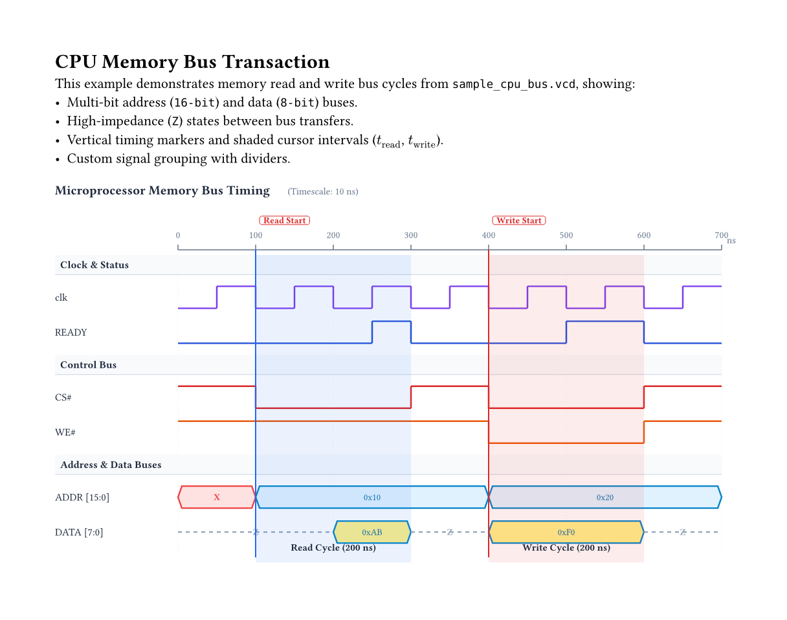
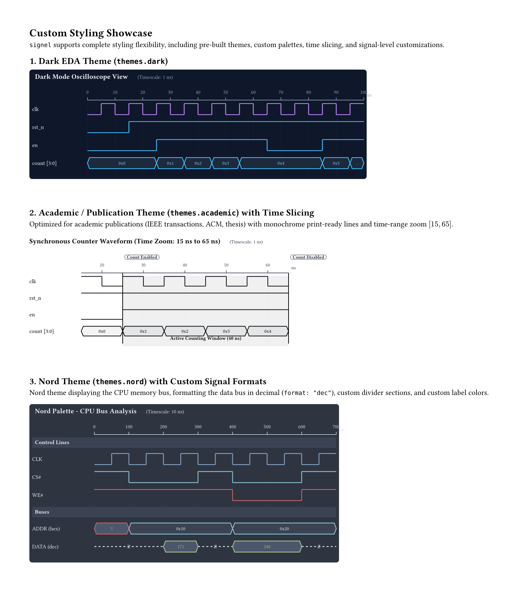
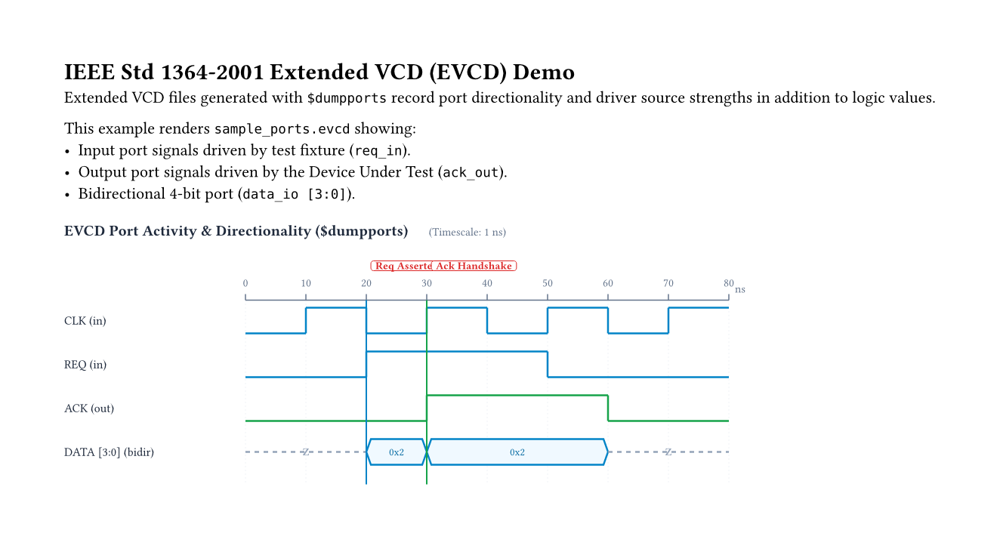

# `signel` — Typst Waveform Embedding Package

> Embed IEEE Std 1364-2001 Value Change Dump (**VCD**) and Extended Value Change Dump (**EVCD**) waveforms directly into Typst documents with rich, customizable styling.

---

## Features

- **100% OS-Agnostic & Pure Typst**:
  - Implemented entirely in native Typst code.
  - Zero external software, binaries, or build steps required.
  - Runs identically on Linux, macOS, Windows, FreeBSD, and in the WebAssembly-based [typst.app](https://typst.app) online editor.
- **Full IEEE Std 1364-2001 Specification Support**:
  - Standard **VCD** traces: scalar values (`0`, `1`, `x`, `z`), binary vectors (`b...`), and real numbers (`r...`).
  - Extended **EVCD** (`$dumpports`): complete support for the 23 port strength and direction characters (`DUNZduLHXTlh01?FAaBbCcf`), with composite, input-only, output-only, and raw decoding modes.
- **Rich Vector Waveform Rendering**:
  - Digital square waves for 1-bit clocks and control signals.
  - Hexagonal beveled envelopes for multi-bit buses with automatic formatting.
  - High-impedance ($Z$) centered dashed lines and unknown ($X$) shaded warning regions.
  - Section dividers with headers for grouping complex SoC/bus traces.
  - Precision vertical timing markers and shaded cursor intervals ($\Delta t$).
- **Bit Slicing & Flexible Signal Matching**:
  - Slice single bits (`sw[0]`, `count[1]`) or sub-bus ranges (`data[7:4]`, `count[3:1]`) on the fly.
  - Sliced single bits are automatically rendered as digital 1-bit square waveforms.
  - Seamlessly handles whitespace differences (e.g. `sw[1:0]` matches `sw [1:0]`).
- **Data Interpreters & Auto-Decoding**:
  - **7-Segment Display Decoding**: Decodes active-low (0=ON) or active-high (1=ON) 7-segment segment patterns into hex digits (`0`--`F`, `-`, blank), with 8-bit DP support.
  - **Signed 2's Complement**: Decodes signed integers (`format: "signed"`).
  - **One-Hot States**: Decodes active bit index and validates one-hot invariants (`format: "one-hot"`).
  - **Gray Code & Radices**: Gray code conversion, octal, binary, decimal, hex, ASCII, and enum dictionaries.
- **Intelligent Warning & Error Diagnostics**:
  - Clear in-place visual warning banners when a signal is not found (listing available signals from the VCD) or when a bit index is out of bounds.
  - Visual error highlighting (`⚠️ ?` or `⚠️ ERR`) on waveform segments that were encoded wrong.
  - Optional `strict: true` mode to panic during compilation for CI test verification.
- **Custom Styling & Theming**:
  - 7 built-in themes: `themes.default`, `themes.dark`, `themes.academic`, `themes.nord`, `themes.dracula`, `themes.emerald`, and `themes.amber`.
  - Customizer helper `vcd-theme(...)` for fine-grained color, dimension, and font control.
  - Time range slicing (`time-range: (start, end)`) to zoom into specific simulation windows.

---

## Software & Installation Requirements

Because `signel` is implemented **directly in pure Typst code**, **no external binaries or third-party parsing tools are required**. The entire lexing, parsing, and vector rendering pipeline executes inside the Typst compiler.

### Required Software

The only software needed is the **Typst compiler** (version 0.11.0 or newer). Typst is already installed on your system:
```bash
typst --version   # typst 0.15.1
```

### Official Links for Verification

If you or your team need to verify or update your Typst installation:
- **Typst Official Website**: [https://typst.app](https://typst.app)
- **Typst GitHub Repository**: [https://github.com/typst/typst](https://github.com/typst/typst)
- **Typst Official Releases**: [https://github.com/typst/typst/releases](https://github.com/typst/typst/releases)
- **Typst Package Ecosystem (Typst Universe)**: [https://typst.app/universe](https://typst.app/universe)

---

## Installation

### Option 1: Local Typst Package (Recommended)

Copy or symlink `signel` to your local Typst package directory:

```bash
mkdir -p ~/.local/share/typst/packages/local/signel/0.1.1
cp -r typst.toml lib.typ src ~/.local/share/typst/packages/local/signel/0.1.1/
```

Then in any Typst document:
```typst
#import "@local/signel:0.1.1": render-vcd, themes
```

### Option 2: Direct Relative Import

Include `signel` directly in your project:
```typst
#import "path/to/signel/lib.typ": render-vcd, themes
```

---

## Quick Start Example

```typst
#import "@local/signel:0.1.1": render-vcd, themes

#set page(width: auto, height: auto, margin: 1cm)

#render-vcd(
  read("counter.vcd"),
  title: "4-Bit Counter Timing",
  signals: ("clk", "rst_n", "en", "count [3:0]"),
  time-step-width: 4pt,
  theme: themes.default,
  markers: (
    (time: 15, label: "Reset Released", stroke: 1pt + rgb("16a34a")),
  ),
  cursors: (
    (start: 25, end: 65, label: "Count Active (40 ns)"),
  ),
)
```

---

## Visual Previews

### 1. CPU Memory Bus Transaction (`examples/bus_signals.typ`)


### 2. Multi-Theme Showcase (`examples/custom_styling.typ`)


### 3. Extended VCD `$dumpports` (`examples/evcd_demo.typ`)


---

## Project Structure

```
signel/
├── typst.toml                  # Typst package manifest
├── lib.typ                     # Main package entrypoint
├── src/
│   ├── parser.typ              # IEEE Std 1364-2001 VCD & EVCD parser
│   ├── renderer.typ            # Waveform vector rendering engine
│   ├── themes.typ              # Built-in themes & vcd-theme helper
│   └── util.typ                # Radix converters, time formatting, name parser
├── docs/
│   ├── index.md                # Documentation homepage
│   ├── api.md                  # Comprehensive API reference
│   ├── format-vcd-evcd.md      # IEEE 1364-2001 standard & EVCD character matrix
│   └── styling-guide.md        # Theming, bus formats, markers & layouts
└── examples/
    ├── basic.typ               # Basic synchronous counter example
    ├── bus_signals.typ         # Memory bus with dividers, markers & cursors
    ├── evcd_demo.typ           # Extended VCD ($dumpports) port demo
    ├── custom_styling.typ      # Dark, Academic, and Nord themes showcase
    ├── sample_counter.vcd      # Standard VCD trace
    ├── sample_cpu_bus.vcd      # Complex multi-bus VCD trace
    └── sample_ports.evcd       # IEEE 1364-2001 EVCD port trace
```

---

## Documentation Links

- [API Reference](docs/api.md)
- [IEEE Std 1364-2001 VCD & EVCD Format Guide](docs/format-vcd-evcd.md)
- [Styling & Theming Guide](docs/styling-guide.md)

---

## License

MIT License. See [LICENSE](LICENSE) for details.
